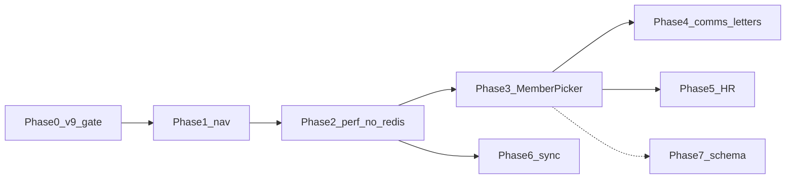

# Nexapoint — todo-v10 (بسته ۱۰ · updates/09)

**بستهٔ v10:** بازخورد UAT پوشه‌های `updates/09`، ناوبری میز کار، عملکرد بدون Redis، MemberPicker، پرسنل/HR، بستن carry-overهای [`todo-v9.md`](todo-v9.md).

**جمع‌بندی کارفرما (aa):** [`updates/09/aa/explain.txt`](updates/09/aa/explain.txt) · [`REPORT.fa.md`](updates/09/aa/REPORT.fa.md) · Self-QA: [`DEV_SELF_QA_MEIZITO.md`](updates/09/aa/DEV_SELF_QA_MEIZITO.md)

**استراتژی:** [BUNDLE-10-STRATEGY.fa.md](updates/09/BUNDLE-10-STRATEGY.fa.md) (v1.1+) · **UAT prod:** [V10-PROD-UAT-COPILOT-PLAN.fa.md](updates/09/V10-PROD-UAT-COPILOT-PLAN.fa.md)  
**نیازمندی محصول (مرجع):** [updates/08/01](updates/08/01-workspace-requirements.md) … [11](updates/08/11-hr-request-rules-requirements.md)  
**خارج از scope v10:** Redis/کش سرور (→ [v10.1](#v101--آینده-redis-معلق)) · داشبورد ERP سند 12 (→ [v9.1 در todo-v9](todo-v9.md#v91--داشبورد-خارج-از-v9))

---

## راهنمای چک‌باکس

| نماد | معنی |
|------|------|
| **کد** | پیاده‌سازی در git |
| **دیپلوی** | روی `https://nexapoint.ir` / پاد تأیید شده |
| **UAT** | سناریو Pass با شواهد (`updates/09/reports/` یا `updates/08/reports/`) |

**ترتیب Agent:** فاز ۰ → ۱ → ۲ → ۳ → (۴ و ۵ موازی پس از ۳) → ۶ → ۷ (موازی با ۳–۵).  
**قانون:** تا درگاه فاز جاری سبز نشود، فاز بعدی را شروع نکن — مگر آیتم‌های صریحاً «موازی».



---

## فهرست فازها

| فاز | عنوان |
|-----|--------|
| [۰](#فاز-۰--زیرساخت-و-بستن-درگاه-v9) | زیرساخت و بستن درگاه v9 |
| [۱](#فاز-۱--p0-ناوبری-و-اعتماد) | P0 ناوبری و اعتماد |
| [۲](#فاز-۲--عملکرد-میز-کار-بدون-redis) | عملکرد میز کار (۲a، بدون Redis) |
| [۳](#فاز-۳--memberpicker-و-میز-کار) | MemberPicker و میز کار |
| [۴](#فاز-۴--گفتگو-و-نامه) | گفتگو و نامه |
| [۵](#فاز-۵--پرسنل--hr--گزارش-روزانه) | پرسنل / HR / گزارش روزانه |
| [۶](#فاز-۶--همزمانی-تیمی) | هم‌زمانی تیمی (بدون Redis) |
| [۷](#فاز-۷--بهداشت-اسکیما) | بهداشت اسکیما |
| [v9-carry](#v9-carry--deployuat-باز-از-v9) | deploy/UAT باز از v9 |
| [v10.1](#v101--آینده-redis-معلق) | آینده: Redis (معلق) |
| [DoD](#definition-of-done-بسته-۱۰) | Definition of Done |

---

## شما الان کجایید؟

**وضعیت:** دیپلوی پچ aa [x] · env prod (`CRM_FAUX=false`, storage=db) [x] — [`prod-env-2026-11-21.md`](updates/09/reports/prod-env-2026-11-21.md) · UAT: [`uat-v10-smoke.md`](updates/09/reports/uat-v10-smoke.md) · **هم‌تراز:** ۲۰۲۶-۱۱-۲۱

| فاز v10 | وضعیت پیشنهادی | گام بعد |
|---------|----------------|--------|
| ۰ | دیپلوی [x] · env [x] | ۰.۵ پاک DB · ۰.۳ backfill · smoke CRM |
| ۱ | دیپلوی [x] · UAT IA جزئی [x] | ۱.۷ Pass کامل + اسکرین 09/03 |
| ۲ | کد+دیپلوی [x] | ۲.۸ p95 · درگاه UAT فاز ۲ |
| ۳ | دیپلوی [x] | UAT ۳.۱–۳.۸ (UX-002) |
| ۴ | دیپلوی [x] | UAT ویس/نامه/چت |
| ۵ | ۵.۱ UAT [x] · ۵.۴ کد [x] | دیپلوی ۵.۴ · UAT پرونده/org |
| ۶ | کد+دیپلوی [x] | UAT ۶.۱–۶.۲ |
| ۷ | docs [x] | ۷.۲ · ۷.۵ بعد v10 |

---

## فاز ۰ — زیرساخت و بستن درگاه v9

**هدف:** دادهٔ prod فقط از DB؛ بستن remediation و UAT باز v9 قبل از محصول v10.

| # | کار | کد | دیپلوی | UAT | یادداشت |
|---|-----|----|--------|-----|---------|
| 0.1 | `MEIZITO_WORKSPACE_STORAGE=db`, `MEIZITO_COMMS_STORAGE=db` | [x] | [x] | — | `.env.production` — [استراتژی §2.4](updates/09/BUNDLE-10-STRATEGY.fa.md) |
| 0.2 | `prisma migrate deploy` روی prod | [x] | [x] | — | هم‌تراز todo-v9 0.1 |
| 0.3 | backfill: `backfill-workspace-p1`, `backfill-meizito-comms-p2` (در صورت نیاز) | [ ] | [ ] | — | todo-v9 0.4 |
| 0.4 | deploy یکجای remediation **5.06–5.11** | [x] | [x] | [ ] | Runflare ۲۰۲۶-۱۱-۲۱ — [جدول v9-carry](#v9-carry--deployuat-باز-از-v9) |
| 0.5 | ممیزی یک business: داده در جداول نرمال، نه slice یتیم | [ ] | [ ] | [ ] | گزارش اختیاری `updates/09/reports/` |
| 0.6 | به‌روز [`schema-api-roadmap.md`](schema-api-roadmap.md) — baseline v9 | [ ] | — | — | docs |
| 0.7 | `NEXT_PUBLIC_CRM_FAUX=false` روی prod (مگر UAT عمدی) | [x] | [x] | [ ] | env — تأیید مالک ۲۱/۱۱ · smoke UI باز |
| 0.8 | تکمیل todo-v9 **0.5** پایداری شبکه / lazy load v8 | [ ] | [ ] | [ ] | ارجاع [todo-v9 فاز ۰](todo-v9.md#فاز-۰--پیش‌نیاز-زیرساخت) |

**Redis:** `REDIS_URL` در این فاز **اضافه نشود**.

### درگاه فاز ۰

- [x] دیپلوی 5.06–5.11 روی prod (پچ aa ۲۰۲۶-۱۱-۲۱)
- [~] smoke: ورود · business · داشبورد OK — میز کار/نامه در [`uat-v10-smoke.md`](updates/09/reports/uat-v10-smoke.md)
- [ ] (اختیاری) 0.5 slice audit

---

## فاز ۱ — P0 ناوبری و اعتماد

**هدف:** یادداشت / پروژه / گزارش روزانه «ناپدید» نباشند؛ CRM vs بازدید میدانی قاطی نشود.  
**بازخورد:** [updates/09/03](updates/09/03/) · [2.txt](updates/09/2.txt)

| # | کار | کد | دیپلوی | UAT |
|---|-----|----|--------|-----|
| 1.1 | میانبر **یادداشت‌ها** → `/dashboard/tasks?tab=notes` در دسترسی سریع + موبایل | [x] | [x] | [ ] |
| 1.2 | میانبر **پروژه‌ها** → `?tab=projects` | [x] | [x] | [ ] |
| 1.3 | میانبر **گزارش روزانه** → `?tab=reports&section=daily` (برچسب جدا از ERP) | [x] | [x] | [ ] |
| 1.4 | تفکیک برچسب: «گزارش روزانه» vs «گزارشات و تحلیل‌ها» (`/dashboard/reports`) | [x] | [x] | [ ] |
| 1.5 | نوار تب روی `boards` **یا** هاب میز کار (کارت ورود به تب‌ها) — حداقل یکی | [x] | [x] | [ ] |
| 1.6 | CTA روشن: بازدید **CRM** (`CRM.tsx`) vs **بازدید میدانی** (`FieldVisitModal` / `ReportsPanel`) | [x] | [x] | [ ] |
| 1.7 | UAT smoke با اسکرین‌شات `updates/09/03` | [ ] | [x] | [~] |

**فایل‌های اصلی:** [`src/components/Sidebar.tsx`](src/components/Sidebar.tsx) · [`src/types/meizito.ts`](src/types/meizito.ts) (`showMeizitoWorkspaceTabBar`)

### درگاه فاز ۱

- [x] بدون URL دستی: notes · projects · reports/daily از سایدبار/موبایل (smoke prod ۲۱/۱۱)
- [ ] UAT 1.7 Pass کامل (`updates/09/03` + میانبرها همه سناریوها)

---

## فاز ۲ — عملکرد میز کار (بدون Redis)

**هدف:** کاهش waterfall، SWR، بردها بدون انتظار تقویم؛ **بدون** کش Redis.  
**منبع:** [1.txt](updates/09/1.txt) · استراتژی فاز ۲a

| # | کار | کد | دیپلوی | UAT |
|---|-----|----|--------|-----|
| 2.1 | API سبک‌تر / lazy: عدم بار snapshot سنگین برای تب‌های غیرضروری | [x] | [x] | [ ] |
| 2.2 | حذف قفل `tab=boards` روی hydration تقویم | [x] | [x] | [ ] |
| 2.3 | React Query: SWR، اسکلتون فقط `isLoading` اول، `refetchOnWindowFocus`, `staleTime` کوتاه workspace | [x] | [x] | [ ] |
| 2.4 | `QueryClient` سراسری (نه فقط `MeizitoProviders` در Tasks) | [x] | [x] | [ ] |
| 2.5 | Prefetch `workspace` + `team-directory` پس از `activeBusinessId` (`BusinessGate`) | [x] | [x] | [ ] |
| 2.6 | drag ترتیب ستون در تنظیمات بورد | [x] | [x] | [ ] |
| 2.7 | فیلتر تقویم در create کارت — فقط تقویم‌های کسب‌وکار | [x] | [x] | [ ] |
| 2.8 | اندازه‌گیری time-to-interactive / p95 — لاگ در `updates/09/reports/` | [~] | — | [ ] ([`perf-v10-baseline.md`](updates/09/reports/perf-v10-baseline.md) آماده ثبت) |

**فایل‌های کلیدی:** [`tabHydration.ts`](src/lib/meizito/tabHydration.ts) · [`MeizitoProviders.tsx`](src/context/MeizitoProviders.tsx) · [`MeizitoContext.tsx`](src/context/MeizitoContext.tsx) · [`server-handler.ts`](src/lib/meizito/server-handler.ts) · [`BoardsPanel.tsx`](src/views/meizito/panels/BoardsPanel.tsx)

**یادداشت:** اگر پس از 2.8 p95 هنوز بالاست → تصمیم [v10.1 Redis](#v101--آینده-redis-معلق) (خارج از scope فعلی).

### درگاه فاز ۲

- [ ] `?tab=boards`: محتوا با SWR؛ refetch بدون اسکلتون کامل
- [ ] بوردها بدون انتظار لود کامل تقویم
- [ ] بهبود ≥۴۰٪ نسبت به baseline (ثبت در گزارش)

---

## فاز ۳ — MemberPicker و میز کار

**هدف:** SSOT نام = `team-directory`؛ Catalog فقط CRM.  
**بازخورد:** [updates/09/01](updates/09/01/)

| # | کار | کد | دیپلوی | UAT |
|---|-----|----|--------|-----|
| 3.1 | کامپوننت `BusinessMemberPicker` از `team-directory` | [x] | [x] | [ ] |
| 3.2 | جایگزینی در: تنظیمات بورد، ارجاع کارت، رویداد تقویم | [x] | [x] | [ ] |
| 3.3 | گفتگو: گروه/کانال — اعضا با MemberPicker نه ویرگول | [x] | [x] | [ ] |
| 3.4 | نامه: گیرنده/CC از MemberPicker — [سند 05](updates/08/05-letters-requirements.md) | [x] | [x] | [ ] |
| 3.5 | حذف `PersonCombobox` از مسیر میز کار / چت داخلی / ارجاع وظیفه | [x] | [x] | [ ] |
| 3.6 | لوگو کسب‌وکار در shell (`Header` / business profile) | [x] | [x] | [ ] |
| 3.7 | نمایش avatar اعضا (در صورت نبود فیلد → زیرآیتم schema/UI) | [x] | [x] | [ ] |
| 3.8 | **UX-002:** اعضای پروژه فقط `team-directory` (بدون CRM) — `ProjectsPanel` | [x] | [x] | [ ] |

**ارجاع v9:** تکمیل محصول [5.01](todo-v9.md#فاز-501--میز-کار-سند-01) اعضا/تقویم پس از 3.2.

### درگاه فاز ۳

- [ ] prod: ارجاع وظیفه فقط نام‌های `team-directory`
- [ ] UAT: افزودن عضو میز از لیست تیم (نه Catalog)

---

## فاز ۴ — گفتگو و نامه

**بازخورد:** [09/02](updates/09/02/) · [09/03](updates/09/03/)

| # | کار | کد | دیپلوی | UAT |
|---|-----|----|--------|-----|
| 4.1 | کانال/گروه: انتخاب اعضا، تنظیمات، نقش admin (MVP) | [x] | [x] | [ ] |
| 4.2 | اتصال UI به `ChatThread` / API موجود | [x] | [x] | [ ] |
| 4.3 | منشن، ادیت، حذف، ویس — UAT `09/02`؛ اعتبار نام گروه/کانال (`chat-title.ts`) | [x] | [x] | [ ] |
| 4.4 | نامه: مودال compose، CC، اولویت، MemberPicker — [5.05](todo-v9.md#فاز-505--نامه-سند-05) · aa/`33.txt` | [x] | [x] | [ ] |
| 4.5 | بستن UAT [5.03](todo-v9.md#فاز-503--گفتگو-سند-03) smoke · [5.04](todo-v9.md#فاز-504--یادداشت-سند-04) در صورت باز | [~] | [x] | [~] ([`uat-v10-smoke.md`](updates/09/reports/uat-v10-smoke.md)) |

**فایل‌ها:** [`MeizitoChatEmbed.tsx`](src/views/meizito/components/MeizitoChatEmbed.tsx) · [`NewChatModals.tsx`](src/views/meizito/components/NewChatModals.tsx) · [`LettersPanel.tsx`](src/views/meizito/panels/LettersPanel.tsx)

---

## فاز ۵ — پرسنل / HR / گزارش روزانه

**بازخورد:** [09/05](updates/09/05/)–[09/08](updates/09/08/)

| # | کار | کد | دیپلوی | UAT |
|---|-----|----|--------|-----|
| 5.1 | IA **پرسنل**: سایدبار → `/dashboard/hr?tab=requests` (حذف منوی جدا work-requests) · مسیر قدیمی برای صندوق اداری | [x] | [x] | [x] |
| 5.2 | چارت درختی org — `parentId` در API/UI · سلسله پرسنل + تماس/ایمیل (`HrOrgUnitsPanel`) | [x] | [x] | [ ] |
| 5.3 | گزارش روزانه + فیدبک از دسترسی سریع / پرسنل | [x] | [x] | [ ] |
| 5.4 | پرونده پرسنلی — فرم گسترش‌پذیر + **آپلود/تأیید مدارک** (aa/`42.png`) — [5.10](todo-v9.md#فاز-510--hr-سازمان-سند-10) | [x] | [ ] | [ ] |
| 5.5 | درخواست HR + eligibility UAT — [5.11](todo-v9.md#فاز-511--قوانین-hr-سند-11) | [x] | [x] | [ ] |
| 5.6 | تعریف سازمان در تنظیمات؛ HR مصرف‌کننده | [x] | [x] | [ ] |

**فایل‌ها:** [`HR.tsx`](src/views/HR.tsx) · [`WorkRequests.tsx`](src/views/WorkRequests.tsx) · [`HrOrgUnitsPanel.tsx`](src/views/hr/HrOrgUnitsPanel.tsx) · [`ReportsPanel.tsx`](src/views/meizito/panels/ReportsPanel.tsx)

---

## فاز ۶ — هم‌زمانی تیمی

**بدون Redis / WebSocket در v10** — polling یا SSE سبک.

| # | کار | کد | دیپلوی | UAT |
|---|-----|----|--------|-----|
| 6.1 | تکمیل `invalidateQueries` پس از mutationهای workspace | [x] | [x] | [ ] |
| 6.2 | polling ۲۰–۳۰ث وقتی تب `boards` فعال | [x] | [x] | [ ] |
| 6.3 | (اختیاری) SSE per business — بدون pub/sub Redis | [ ] | [ ] | [ ] |

---

## فاز ۷ — بهداشت اسکیما

**بازخورد:** [09/09](updates/09/09/) · بدون ریست اسکیما

| # | موضوع | کد | docs/migration | UAT |
|---|--------|----|----------------|-----|
| 7.1 | `BusinessProject` vs `WorkspaceProject` — نام UI و docs | [x] | [x] | — |
| 7.2 | `CrmVisit` vs `WorkspaceFieldVisit` — جداسازی در docs/UI | [x] | [ ] | — |
| 7.3 | prod فقط `db`؛ deprecate `slice`/`dual` در dev docs | [x] | [x] | — |
| 7.4 | طرح migration `board.memberUserIds[]` | [x] | [x] | — |
| 7.5 | `NoteBoardLabel` — todo-v9 فاز 1.3 باز | [ ] | — | — (بعد از v10) |
| 7.6 | `OrgUnit.parentId` در API POST/ویرایش | [x] | [x] | [ ] |
| 7.7 | سند [`updates/09/schema-alignment.md`](updates/09/schema-alignment.md) جدول مدل→API→UI | [x] | [x] | — |

---

## v9-carry — deploy/UAT باز از v9

**منبع:** [todo-v9 «شما الان کجایید»](todo-v9.md#شما-الان-کجایید)

| فاز v9 | سند | کد | دیپلوی | UAT |
|--------|-----|----|--------|-----|
| 5.04 | 04 یادداشت | [x] | [x] | [ ] |
| 5.05 | 05 نامه | جزئی | [x] | [~] |
| 5.06 | 06 درخواست | [x] | [x] | [ ] |
| 5.07 | 07 تلفن — ولیدیشن ۱۱ رقمی + دسته اجباری (`35.txt`) | [x] | [x] | [ ] |
| 5.08 | 08 گزارش | [x] | [x] | [ ] |
| 5.09 | 09 پروژه — parity میزیتو (فضا+کانبان+تقویم) aa/`52.txt` | [~] | [x] | [ ] |
| 5.10 | 10 HR | [x] | [x] | [~] |
| 5.11 | 11 eligibility | [x] | [x] | [ ] |

**UAT راهنما:** [UAT-TEST-GUIDE](updates/08/reports/UAT-TEST-GUIDE.md) · [UAT-REMEDIATION-CHECKLIST](updates/08/reports/UAT-REMEDIATION-CHECKLIST.md)

---

## v10.1 — آینده (Redis معلق)

**خارج از scope اجرای v10.** زیرساخت `nexapointredis` روی پنل آماده است؛ اپ هنوز متصل نیست.

پیش‌شرت: تکمیل [فاز ۲](#فاز-۲--عملکرد-میز-کار-بدون-redis) + اندازه‌گیری p95 · API تقسیم‌شده · invalidate در server-handler.

جزئیات: [BUNDLE-10-STRATEGY §5](updates/09/BUNDLE-10-STRATEGY.fa.md).

**هیچ چک‌لیست اجرایی در v10 برای Redis تعریف نشده است.**

---

## Definition of Done بسته ۱۰

### P0 (الزام انتشار)

- [x] از سایدبار بدون URL دستی: یادداشت، پروژه، گزارش روزانه — UAT prod ۲۰۲۶-۱۱-۲۱ (تأیید مالک)
- [ ] کاربر prod فقط نام‌های `team-directory` در میز کار / ارجاع (UX-002 دیپلوی [x] — UAT باز)
- [x] env storage = `db`
- [ ] نمونهٔ تست بدون slice یتیم (فاز 0.5)
- [x] CRM visit و field visit مسیر جدا و برچسب واضح (CRM تب «بازدید مشتری» · میدانی `FieldVisitModal`)

### عملکرد (فاز ۲)

- [ ] `?tab=boards`: SWR بدون اسکلتون کامل روی refetch
- [ ] بوردها بدون انتظار لود کامل تقویم
- [ ] بهبود measurable time-to-interactive

### هم‌زمانی

- [ ] refetch on window focus (workspace)
- [ ] invalidate پس از mutation خود کاربر
- [ ] (اختیاری) polling روی boards

### HR

- [ ] حداقل یک درخت org با parent در UI (UX-001 — کد+دیپلوی [x] — اسکرین/UAT v2 باز)
- [x] گزارش روزانه از دسترسی سریع — UAT prod (NN05)

### Self-QA (aa / explain)

- [ ] ۲–۳ بار مقایسه با میزیتو قبل از تحویل — [`DEV_SELF_QA_MEIZITO.md`](updates/09/aa/DEV_SELF_QA_MEIZITO.md)

---

## برنامهٔ ۴ هفته (راهنما)

| هفته | تمرکز |
|------|--------|
| ۱ | فاز ۰ deploy v9-carry + فاز ۱ ناوبری |
| ۲ | فاز ۲ عملکرد + شروع فاز ۳ MemberPicker |
| ۳ | فاز ۳ کامل + فاز ۴ چت/نامه |
| ۴ | فاز ۵ HR + فاز ۶ sync · بستن v9 UAT |

---

## پیوست A — نگاشت `updates/09` → فاز v10

| پوشه | خواسته | فاز v10 |
|------|--------|---------|
| 01 | اعضا، ستون، تقویم، لوگو | ۲، ۳ |
| 02 | چت واتساپی | ۴ |
| 03 | نامه، ناوبری | ۱، ۴ |
| 04 | ولیدیشن تلفن | v9-carry 5.07 |
| 05–08 | HR، پرسنل، گزارش | ۵ |
| 09 | اسکیما، CRM vs field visit | ۰، ۱، ۷ |
| **aa** | جمع‌بندی + Self-QA + parity | ۱–۷، DoD · [`explain.txt`](updates/09/aa/explain.txt) |

---

## پیوست E — نگاشت `aa/explain` → فاز (خلاصه)

| تم explain | فاز todo |
|------------|----------|
| Parity میزیتو + Self-QA | DoD · DEV_SELF_QA |
| فیک/CRM_FAUX/MemberPicker | ۰.۷، ۳ |
| ناوبری، گزارش روز vs ERP | ۱ |
| p95 میز کار | ۲.۸ |
| نامه مودال/CC | ۴ |
| واتساپ ویس/کانال | ۴.۳ |
| پرسنل/چارت/پرونده | ۵ |
| تلفن ۱۱ رقمی | v9 5.07 |
| پروژه MeisterTask | v9 5.09 |
| اسکیما بدون ریست | ۷ |

---

## پیوست B — شش منبع نام (قانون UI)

| # | منبع | مسیر |
|---|------|------|
| 1 | اعضای زنده | `team-directory` |
| 2 | Mock میزیتو | `MEIZITO_MOCK_USERS` — فقط dev |
| 3 | ثابت UI | `MEIZITO_CURRENT_USER_NAME` |
| 4 | Catalog ERP | `catalogSeed` / `PersonCombobox` — CRM |
| 5 | دمو ماژول‌ها | Blog، SalesNetwork، … |
| 6 | mock-bootstrap | `mock-bootstrap.ts` |

**قانون v10:** در `/dashboard/tasks`, `/dashboard/chats`, `/dashboard/hr` فقط منبع ۱ (+ `/api/auth/me`).

---

## پیوست C — env پروداکشن

- [x] `MEIZITO_WORKSPACE_STORAGE=db`
- [x] `MEIZITO_COMMS_STORAGE=db`
- [x] `NEXT_PUBLIC_FRONTEND_ONLY=false`
- [x] `NEXT_PUBLIC_CRM_FAUX=false` (پاد ۲۰۲۶-۱۱-۲۱)
- [x] `REDIS_URL` خالی — **عمداً در v10**

---

## پیوست D — پرامپت Cursor Agent

```text
پروژه Nexapoint — فقط todo-v10.md (مکمل todo-v9).
الان: فاز {۰–۷}. تا درگاه آن فاز سبز نشود به فاز بعد نرو.
Redis در v10 ممنوع — فقط v10.1 مستند.
هر تغییر محصول: cite updates/08/0N-* و بازخورد updates/09/0N.
پس از deploy: به‌روز ستون دیپلوی/UAT همان فاز.
```

---

## چک‌لیست باز (فقط انجام‌نشده · ۲۰۲۶-۱۱-۲۱)

### فاز ۰
- [ ] ۰.۳ backfill (در صورت نیاز)
- [ ] ۰.۴ UAT remediation
- [ ] ۰.۵ ممیزی DB / حذف seed
- [ ] ۰.۶ `schema-api-roadmap.md`
- [ ] ۰.۷ UAT smoke «بدون lead فیک» در CRM
- [ ] ۰.۸ پایداری شبکه v9

### فاز ۱–۲
- [ ] UAT ۱.۱–۱.۶ + درگاه ۱.۷ کامل
- [ ] UAT عملکرد ۲.۱–۲.۷ + درگاه فاز ۲
- [ ] ۲.۸ p95 در `perf-v10-baseline.md`

### فاز ۳–۴
- [ ] UAT MemberPicker / UX-002 (۳.۱–۳.۸)
- [ ] UAT چت (ویس ۴.۳) · نامه ۴.۴ · smoke ۴.۵

### فاز ۵–۶
- [ ] **۵.۴** دیپلوی + UAT آپلود/تأیید (کد [x] · فرمساز Settings بعداً)
- [ ] UAT ۵.۲–۵.۶ · v9 **۵.۹ parity پروژه**
- [ ] UAT هم‌زمانی ۶.۱–۶.۲ · (اختیاری) ۶.۳ SSE

### فاز ۷ · DoD · v9 UAT
- [ ] ۷.۲ docs UAT · ۷.۶ UAT
- [ ] Self-QA ۲–۳× میزیتo (`DEV_SELF_QA_MEIZITO.md`)
- [ ] v9-carry UAT ۵.۰۴–۵.۰۸، ۵.۱۱ (و تکمیل ۵.۰۵، ۵.۰۹ محصول)

---

## مرجع

- [`todo-v9.md`](todo-v9.md) · [`updates/09/BUNDLE-10-STRATEGY.fa.md`](updates/09/BUNDLE-10-STRATEGY.fa.md) · [`schema-api-roadmap.md`](schema-api-roadmap.md) · [`prisma/schema.prisma`](prisma/schema.prisma)