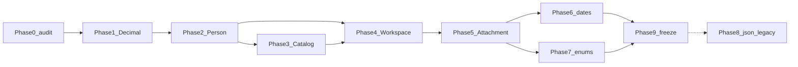

# Nexapoint — todo-v11 (بهداشت اسکیما و Single Source of Truth)

**هدف:** اصلاح `prisma/schema.prisma` پس از baseline AI Studio (`20261123000000_baseline`) — **بدون ریست کل اسکیما**؛ آماده‌سازی **freeze** قبل از بستن UAT در [todo-v10.md](todo-v10.md).

**ممیزی اولیه:** [docs/schema-v11-audit.md](docs/schema-v11-audit.md)  
**اسکیما لایو:** [prisma/schema.prisma](prisma/schema.prisma)  
**نقشه API:** [schema-api-roadmap.md](schema-api-roadmap.md)  
**بازخورد محصول (بعد از freeze):** [updates/01](updates/01/) · [todo-v10.md](todo-v10.md)

**خارج از scope v11:** ناوبری/منو، Redis، UAT prod، seed fixture جدید (تا پایان فاز ۲–۳).

---

## راهنمای چک‌باکس

| نماد | معنی |
|------|------|
| **schema** | تغییر `schema.prisma` |
| **migration** | `prisma migrate dev` + `migrate deploy` روی dev/staging |
| **backfill** | اسکریپت `scripts/` برای داده موجود |
| **app** | API / service / Zod / UI |
| **test** | `npm run test:v9-schema-contract` و تست‌های فاز |

**ترتیب Agent:** فاز ۰ → ۱ → ۲ → ۳ → ۴ → ۵ → (۶ و ۷) → **۹ freeze** → (۸ تدریجی پس از freeze)  
**قانون:** تا **درگاه فاز جاری** سبز نشود فاز بعدی شروع نشود. **فاز ۸ Json** blocker اسکیما نیست.

---

## فهرست فازها

| فاز | عنوان |
|-----|--------|
| [۰](#فاز-۰--ممیزی-و-خط-قرمز) | ممیزی و خط قرمز |
| [۱](#فاز-۱--p0-مبالغ-float--decimal) | P0 مبالغ Float → Decimal |
| [۲](#فاز-۲--ssot-اشخاص-person) | SSOT اشخاص (Person) |
| [۳](#فاز-۳--ssot-کالا-catalogproduct) | SSOT کالا (CatalogProduct) |
| [۴](#فاز-۴--workspace-کانبان) | Workspace / کانبان |
| [۵](#فاز-۵--پیوست-مرکزی-attachment) | پیوست مرکزی (Attachment) |
| [۶](#فاز-۶--تاریخ‌های-قابل-مرتب‌سازی) | تاریخ‌های قابل مرتب‌سازی |
| [۷](#فاز-۷--وضعیت‌ها--enum) | وضعیت‌ها → enum |
| [۸](#فاز-۸--json-legacy-تدریجی) | Json legacy (تدریجی) |
| [۹](#فاز-۹--freeze-و-بازگشت-به-v10) | Freeze و بازگشت به v10 |

---

## شما الان کجایید؟

| وضعیت | توضیح |
|--------|--------|
| Baseline | `prisma/migrations/20261123000000_baseline` |
| **Freeze v11** | [docs/schema-v11-freeze.md](docs/schema-v11-freeze.md) — قفل ۲۰۲۶-۱۱-۲۴ |
| SSOT | Person + Catalog + Workspace + Attachment **اعمال شد** (فاز ۲–۵) |
| مالی | **`Float` = ۰** — فاز ۱ Decimal |
| Json | **~۵۶** فیلد — **فاز ۸ پس از freeze** (تدریجی) |
| گام بعد | **UAT v10** + Playwright smoke — [todo-v10.md](todo-v10.md) |

---

## فاز ۰ — ممیزی و خط قرمز

**هدف:** نقشه واقعی قبل از migration؛ **بدون** تغییر مدل (جز مستندات).

| # | کار | schema | migration | یادداشت |
|---|-----|--------|-----------|---------|
| 0.1 | `npx prisma validate` | — | — | blocker |
| 0.2 | تکمیل [docs/schema-v11-audit.md](docs/schema-v11-audit.md) | — | — | [x] نسخه اول |
| 0.3 | سیاست پول: ریال `Decimal(20,0)` + نرخ `Decimal(18,6)` | — | — | [x] audit §۲ |
| 0.4 | سیاست تاریخ: `DateTime` vs `dateKey` شمسی استاندارد | — | — | audit §۳ |
| 0.5 | لیست Json legacy (Person/Catalog/WarehouseItem/Meta/Meizito) | — | — | audit §۴ |
| 0.6 | هم‌تراز `scripts/test-v9-deploy.mts` با baseline `20261123000000` | — | — | [x] |
| 0.7 | DB جدا برای migration آزمایشی + backup قبل از staging | — | — | |
| 0.8 | **ممنوعیت:** regenerate کل `schema.prisma` در AI Studio — فقط پچ فازبه‌فاز | — | — | |

### درگاه فاز ۰

- [x] `docs/schema-v11-audit.md` وجود دارد
- [x] سیاست Money ثبت شد (Date هنوز §۳)
- [x] `prisma validate` سبز
- [x] `test:v9-deploy` Pass روی DB (پس از v11 migration)

---

## فاز ۱ — P0 مبالغ (Float → Decimal)

**هدف:** حذف خطای ممیز شناور در تراز، چک، فاکتور، حقوق.

**مدل‌ها (مرجع):** `MoneyDocument`, `CommerceDocument`, `ExchangeRate`, `CrmOpportunity`, `BankAccount`, `Cashbox`, `PettyCash`, `BankTransaction`, `FundTransfer`, `CheckItem`, `AccountingAccount`, `JournalEntry`, `JournalLine`, `WarehouseVoucherItem`, `StocktakingRow`, `CustomerOrder`, `PayrollPeriodSummary`, `SalesNetworkMember`, `SalesCommission`, `MarketingCampaign`, `WarrantyRecord`, `AfterSalesTicket`, `InquiryRecord`, `StoreProduct`, `StoreOrder`, `StoreOrderItem`, `ShareholderRecord`/`VendorRecord` (درصد), …

| # | کار | schema | migration | backfill | app | test |
|---|-----|--------|-----------|----------|-----|------|
| 1.1 | helper: `src/lib/money/decimal.ts` | [x] | — | — | [x] | — |
| 1.2 | دسته ۱: بانک + چک + حسابداری + `ExchangeRate` | [x] | [x] `20261124142921_…` | (cast DB) | [x] | [x] |
| 1.3 | دسته ۲: commerce + money documents | [x] | [x] `20261124144245_…` | (cast DB) | [x] | [x] |
| 1.4 | دسته ۳: store + payroll + CRM amount + انبار qty | [x] | [x] (همان migration) | (cast DB) | [x] | [x] |
| 1.5 | API: سریالایز Decimal بدون شکستن JSON فرانت | — | — | — | [x] | [x] deploy |
| 1.6 | تست: سند متوازن — Σ debit = Σ credit | — | — | — | — | [~] تأیید کاربر بدون UI |

### درگاه فاز ۱

- [x] دسته ۱ (بانک/حسابداری) migration روی DB
- [x] دسته ۲ commerce + money documents
- [x] دسته ۳ store + payroll + CRM + انبار qty
- [x] درگاه UI — **رد شده با تأیید کاربر** (۱۴۰۴/۰۹/۰۳)

---

## فاز ۲ — SSOT اشخاص (Person)

**هدف:** FK واقعی با کلید مرکب `@@id([businessId, personId])`؛ حذف کپی نام/موبایل where possible.

| # | کار | schema | migration | backfill | app | test |
|---|-----|--------|-----------|----------|-----|------|
| 2.1 | `ShareholderRecord` → `@relation` به `Person` | [x] | [x] | [x] SQL orphan | [x] | [x] |
| 2.2 | `VendorRecord` → `Person` | [x] | [x] | [x] | [x] | [x] |
| 2.3 | `CrmClubMember`: FK + استراتژی نام نمایشی (Person یا snapshot) | [x] | [x] | [x] | [x] نام snapshot | [x] |
| 2.4 | `CrmOpportunity.personId` → FK | [x] | [x] | [x] | [x] | [x] |
| 2.5 | `PhoneDirectoryEntry`: FK `User` / `Person` + `PhoneDirectoryEntryKind` | [x] | [x] | [x] | [x] | [x] |
| 2.6 | `SalesNetworkMember`: اضافه `personId?` یا `userId?`؛ حذف تکرار `fullName`/`phone` تدریجی | [x] | [x] | — | [x] POST/PATCH | [x] |
| 2.7 | `WorkspaceBoardMember.personId` → FK | [x] | [x] | [x] | [~] workspace هنوز displayName | [x] |

### درگاه فاز ۲

- [x] درج `personId` نامعتبر در DB رد شود (FK + `requirePersonInBusiness`)
- [ ] `npm run db:tenant-ronak` پس از تغییر — پیشنهاد بعد از seed یک بار اجرا کنید

---

## فاز ۳ — SSOT کالا (CatalogProduct)

**هدف:** یک کالا — کاتالوگ، فروشگاه، انبار.

| # | کار | schema | migration | backfill | app | test |
|---|-----|--------|-----------|----------|-----|------|
| 3.1 | `StoreProduct`: `businessId` + `productId` یا `catalogProductId` → FK مرکب | [x] | [x] `20261124160000_…` | [x] | [x] | [x] |
| 3.2 | نرمال‌سازی `WarehouseItem` (جایگزین `data Json`) + FK کاتالوگ | [x] | [x] | [x] SQL | [x] | [x] |
| 3.3 | `WarehouseVoucherItem`: FK به کد کالا / CatalogProduct | [x] | [x] | [x] | [x] | [x] |
| 3.4 | حذف `price`/`stock`/`total` رشته‌ای در `StoreProduct` / `StoreOrder` | [x] | [x] | — | [x] API format | [x] |
| 3.5 | سیاست sync: تغییر قیمت در Catalog → Store (write یا read-through) | — | — | — | [x] `updateProduct` | [x] |

### درگاه فاز ۳

- [x] SKU با FK کاتالوگ در Store + حواله (`catalogProductId` / `itemCode`→`code`)
- [x] `WarehouseItem` نرمال + API مکان‌ها از `WarehouseLocation`

---

## فاز ۴ — Workspace / کانبان

**هدف:** یک منبع ترتیب کارت‌ها؛ حذف desync `cardIds` vs `columnId`.

| # | کار | schema | migration | backfill | app | test |
|---|-----|--------|-----------|----------|-----|------|
| 4.1 | `WorkspaceCard` → `@relation` به `WorkspaceColumn` | [x] | [x] | [x] | [x] | [x] |
| 4.2 | حذف `WorkspaceColumn.cardIds`؛ `sortOrder` روی Card | [x] | [x] | [x] SQL | [x] | [x] |
| 4.3 | `WorkspaceBoardMember.userId` FK به `User` | [x] | [x] فاز۲ | — | [~] | [x] |
| 4.4 | `WorkspaceCard.assignee` → تکیه بیشتر روی `assigneeUserId` | [x] FK | [x] | — | [~] نام legacy | [x] |
| 4.5 | `WorkspaceProject`: junction برای اعضا (جایگزین `memberIds`/`members` Json) | [x] | [x] | [x] | [x] | [x] |
| 4.6 | `InternalLetterRecipient`: FK `User` برای گیرنده | [x] | [x] | [x] | [~] | [x] |
| 4.7 | `ChatThread`: junction شرکت‌کنندگان (جایگزین `participantNames` Json) | [x] | [x] | [x] | [x] | [x] |

**فایل‌های اپ:** [`workspace-db-service.ts`](src/lib/meizito/workspace/workspace-db-service.ts) · [`MeizitoContext.tsx`](src/context/MeizitoContext.tsx)

### درگاه فاز ۴

- [x] drag کارت بین ستون — `test-meizito-db-p1` (جابجایی columnId + cardIds)
- [x] `test:meizito-db-p1` + `test:v9-deploy` سبز

---

## فاز ۵ — پیوست مرکزی (Attachment)

**هدف:** حذف `imageDataUrl` و آرایه‌های Json تکراری.

| # | کار | schema | migration | backfill | app | test |
|---|-----|--------|-----------|----------|-----|------|
| 5.1 | مدل junction (مثلاً `EntityAttachment`: `entityType`, `entityId`, `attachmentId`) | [x] | [x] | [x] | [x] | [x] |
| 5.2 | `ChatMessage`: حذف `imageDataUrl`؛ migrate به Attachment | [x] | [x] | [x] | [x] | [x] |
| 5.3 | `WorkspaceCard` / `WorkspaceNote` / `InternalLetter` / `InternalWorkRequest` | [x] | [x] | [x] | [x] | [x] |
| 5.4 | یک مسیر آپلود (`fileKey` + storage) برای چت و نامه | — | — | — | [x] | [x] |

### درگاه فاز ۵

- [x] عکس/ویس چت از storage؛ ردیف DB بزرگ base64 صفر در تست (`test:v9-deploy` + `test:v11-phase5-attachments`)

---

## فاز ۶ — تاریخ‌های قابل مرتب‌سازی

**هدف:** فیلتر بازه در DB؛ تقویم شمسی در لایه نمایش.

| # | کار | schema | migration | backfill | app | test |
|---|-----|--------|-----------|----------|-----|------|
| 6.1 | ERP مالی: `JournalEntry.date`, `BankTransaction.date`, `CheckItem.dueDate`, … | [x] | [x] | [x] | [x] | [x] |
| 6.2 | `AttendanceLog.workDate` | [x] | [x] | [x] | [x] | [x] |
| 6.3 | `BlogPost` / `BlogComment` / `StoreOrder.date` | [x] | [x] | [x] | [x] | [x] |
| 6.4 | سیاست `MeizitoCalendarEvent.dateKey` (نگه‌داری یا migrate) | [x] | [x] | [x] | [x] | [x] |
| 6.5 | کارت میز کار `dueDate` شمسی — قرارداد با [`task-calendar-contract`](src/lib/meizito/task-calendar-contract.ts) | — | — | — | [x] | [x] |

### درگاه فاز ۶

- [x] گزارش حضور/حسابداری: فیلتر ماه در query DB (`journalMonth` / `attendanceMonth` + `test:v11-phase6-sortable-dates`)

---

## فاز ۷ — وضعیت‌ها → enum

**هدف:** slug انگلیسی در DB؛ برچسب فارسی فقط UI.

| # | مدل / فیلد | schema | migration | backfill | app |
|---|------------|--------|-----------|----------|-----|
| 7.1 | `InternalLetter.status`, `box`, `approvalState` | [x] | [x] | [x] | [x] |
| 7.2 | `InternalWorkRequest.status`, `priority` | [x] | [x] | [x] | [x] |
| 7.3 | `CustomerOrder`, `ProductionOrder`, `StoreOrder`, `WarehouseVoucher.status` | [x] | [x] | [x] | [x] |
| 7.4 | `BlogPost.status` تکراری → حذف به نفع `publishState` | [x] | [x] | [x] | [x] |
| 7.5 | `CrmLead.status`, `CrmClubMember.status` | [x] | [x] | [x] | [x] |

### درگاه فاز ۷

- [x] API بدون مقایسه رشته فارسی سخت‌کد برای flow اصلی (`test:v11-phase7-flow-status`)

---

## فاز ۸ — Json legacy (تدریجی)

> **پس از freeze v11** — هر بلوک promote جدا؛ جزئیات و تصمیم → [docs/schema-v11-freeze.md](docs/schema-v11-freeze.md) § فاز ۸.  
> **قبل از شروع هر 8.x:** اسکیما frozen؛ فقط PR + migration هدفمند.

**بعد از فاز ۲–۵** — هر بلوک promote جدا.

| # | مدل / فیلد | اولویت |
|---|------------|--------|
| 8.1 | `Person.data` | پس از فاز ۲ |
| 8.2 | `CatalogProduct.data` | پس از فاز ۳ |
| 8.3 | `MoneyDocument.data`, `CommerceDocument.data` | با ERP |
| 8.4 | `BusinessPeopleMeta`, `BusinessCatalogMeta`, `BusinessCommerceMeta` | تصمیم: config vs normalize |
| 8.5 | `WorkspaceDailyReport.payload`, `WorkspaceFieldVisit.payload` | جدا از کانبان |
| 8.6 | `HrRequestType.formSchema`, automation `conditionsJson` | باقی‌مانده قابل قبول موقت |

### درگاه فاز ۸

- **شروع فقط پس از freeze** — بدون نیاز به تکمیل همهٔ ردیف‌های بالا برای UAT

---

## فاز ۹ — Freeze و بازگشت به v10

| # | کار | dev | staging |
|---|-----|-----|---------|
| 9.1 | `docs/schema-v11-freeze.md` (تاریخ + hash migration) | [x] | [x] |
| 9.2 | به‌روز [schema-api-roadmap.md](schema-api-roadmap.md) | [x] | [x] |
| 9.3 | `prisma migrate deploy` | [x] | [ ] |
| 9.4 | smoke todo-v10 (منو، MemberPicker، HR) | [ ] | [ ] |
| 9.5 | fixture `db:tenant-ronak` | [x] | [ ] |

### درگاه فاز ۹ (dev)

- [x] `docs/schema-v11-freeze.md`
- [x] `npm run test:v9-deploy` + `test:v11-phase5` … `phase7`
- [x] `npm run db:tenant-ronak`

### Definition of Done — بسته ۱۱

- [x] درگاه فاز ۱–۷ سبز روی **dev**
- [x] SSOT Person + Product + Kanban + Attachment قابل اثبات (تست deploy)
- [x] `test:v9-schema-contract` + deploy test هم‌تراز baseline
- [x] تصمیم مستند برای Jsonهای باقی‌مانده (فاز ۸ در freeze doc)
- [ ] **سپس** ادامه UAT [todo-v10.md](todo-v10.md) + Playwright

---

## پیوست A — دستاوردهای baseline (حفظ شود)

- حذف legacy: `MeizitoSlice`, `ErpPerson`, `BusinessProduct`, Metaهای تک‌فیلد `payload` پراکنده
- ماژول‌های نرمال جدید: بانک، حسابداری، اتوماسیون، گردش‌کار، گارانتی، HR حضور/حقوق، `Attachment`
- `WarehouseVoucher`, `ProductionFormula`, `StoreOrder`, … (جز `WarehouseItem` که هنوز Json است)

## پیوست B — پچ AI Studio (فقط اگر کمک خارجی)

**ممنوع:** بازنویسی کل فایل. **مجاز:** این ۵ بند به‌صورت diff:

1. `Float` مالی → `Decimal`
2. FK مرکب Person در جداول وابسته
3. `catalogProductId` برای Store + Warehouse
4. حذف `cardIds` / رشته‌های تکراری Store / relation کانبان
5. `ChatMessage` بدون `imageDataUrl`؛ junction Attachment

**همیشه:** merge دستی در git + migration در Cursor.

## پیوست C — نگاشت v11 ↔ v10

| v10 (معطل به اسکیما) | v11 فاز |
|----------------------|---------|
| todo-v10 فاز ۷ بهداشت اسکیما | کل v11 |
| todo-v10 فاز ۰.۵ slice audit | پس از freeze (دیگر slice نیست) |
| UAT parity پروژه / HR | بعد از فاز ۹ |

---

## برنامهٔ ۴ هفته (راهنما)

| هفته | تمرکز |
|------|--------|
| ۱ | فاز ۰ + ۱ (Decimal) |
| ۲ | فاز ۲ + ۳ (Person + Catalog) |
| ۳ | فاز ۴ + ۵ (Workspace + Attachment) |
| ۴ | فاز ۶ + ۷ + ۹ freeze |