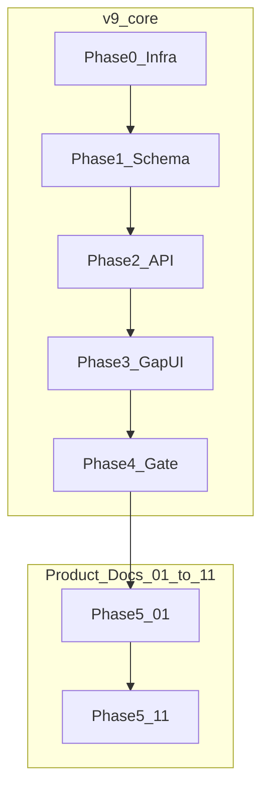

# Nexapoint — todo-v9 (updates/08 · اسناد ۰۱–۱۱)

**بستهٔ v9-core:** اسکیما، API میزیتو، cutover DB، بستن **شکاف‌های پیوست A** + **تکمیل محصول** هر سند ۰۱–۱۱ (فاز ۵).

**خارج از scope v9:** [داشبورد ۱۲](updates/08/12%20داشبورد/New%20Text%20Document.txt) → [§ v9.1](#v91-داشبورد-خارج-از-v9).

**گزارش‌ها:** [UAT-TEST-GUIDE](updates/08/reports/UAT-TEST-GUIDE.md) · [UAT-REMEDIATION-CHECKLIST](updates/08/reports/UAT-REMEDIATION-CHECKLIST.md) · [phase3-functional-log-r2](updates/08/reports/phase3-functional-log-r2.md)

---

## راهنمای چک‌باکس

| نماد | معنی |
|------|------|
| **کد** | پیاده‌سازی در git (ریپو) |
| **دیپلوی** | روی `https://nexapoint.ir` / پاد تأیید شده |
| **UAT** | سناریوی سند Pass در `updates/08/reports/` |

**قانون درگاه هر سند (فاز ۵.0N):** P0 آن سند باید برای **کد + دیپلوی + UAT** سبز باشد.  
**توجه:** `[x] کد` در فاز ۱–۳ یعنی **زیرساخت / شکاف v9-core** — نه تکمیل متن کامل سند محصول.

**ترتیب Agent:** فاز ۴ (بستن v9-core) → سپس ۵.۰۱ → … → ۵.۱۱. اسکیما → API → UI.



---

## فهرست فازها

| فاز | عنوان |
|-----|--------|
| [۰](#فاز-۰--پیش‌نیاز-زیرساخت) | پیش‌نیاز زیرساخت |
| [۱](#فاز-۱--اسکیما-و-قرارداد-نوع-v9-core) | اسکیما v9-core |
| [۲](#فاز-۲--بک‌اند-و-api-v9-core) | بک‌اند v9-core |
| [۳](#فاز-۳--فرانت‌اند-v9-core-پیوست-a) | UI شکاف‌های پیوست A |
| [۴](#فاز-۴--بستن-v9-core-قبل-از-محصول-کامل) | ✅ deploy + UAT r3 (۱۴۰۴/۰۸/۲۱) |
| [۵.01](#فاز-501--میز-کار-سند-01) … [۵.11](#فاز-511--قوانین-hr-سند-11) | تکمیل محصول هر سند |
| [v9.1](#v91-داشبورد-خارج-از-v9) | داشبورد ۱۲ |

**SSOT نیازمندی:** [01](updates/08/01-workspace-requirements.md) … [11](updates/08/11-hr-request-rules-requirements.md)

---

## شما الان کجایید؟

**۵.۰۱–۵.۰۵** دیپلوی قبلی · **۵.۰۶–۵.۱۱ remediation کد [x]** — `npm run build` + `test:v9-backend` OK (۱۴۰۴/۰۸/۲۲) · **شما: push/deploy یکجا** · UAT prod طبق [UAT-TEST-GUIDE §۱۰](updates/08/reports/UAT-TEST-GUIDE.md) و [UAT-REMEDIATION §۱.۴–۱.۵](updates/08/reports/UAT-REMEDIATION-CHECKLIST.md).

| فاز | سند | کد (خلاصه) | دیپلوی | UAT محصول | یادداشت |
|-----|-----|------------|--------|-----------|---------|
| ۴ | — | [x] | [x] | [x] | r3 Pass — نامه approval + HR حضور |
| ۵.01 | 01 | [x] | [x] | [x] | UAT ۵.۰۱ Pass؛ تقویم sync دستی [~] |
| ۵.02 | 02 | [x] | [x] | [~] | smoke: تنظیمات + هفته |
| ۵.03 | 03 | [x] | [x] | [~] | smoke: فوروارد/حذف/ستاره در UI |
| ۵.04 | 04 | [x] | [x] | [ ] | UAT §۹ دستی |
| ۵.05 | 05 | جزئی | [x] | [~] | r3 P0 Pass؛ UAT کامل سند 05 باز |
| ۵.06 | 06 | [x] | [ ] | [ ] | remediation: appendRequest + Prisma 400؛ UAT 5.06-A پس از deploy |
| ۵.07 | 07 | [x] | [ ] | [ ] | کد: نماها + راهنمای visibility؛ deploy/UAT باز |
| ۵.08 | 08 | [x] | [ ] | [ ] | کد: checklist + CSV/z-index؛ UAT 5.08-B پس از deploy |
| ۵.09 | 09 | [x] | [ ] | [ ] | کد: فاز فقط در detail + حذف؛ cleanup فاز UAT دستی |
| ۵.10 | 10 | [x] | [ ] | [~] | کد: Header موبایل؛ r3 حضور Pass؛ payroll باز |
| ۵.11 | 11 | [x] | [ ] | [ ] | فرم typed + eligibility UI؛ UAT حساب دوم باز |

`[~]` = UAT جزئی / smoke فقط.

---

## فاز ۰ — پیش‌نیاز زیرساخت

| # | کار | کد | دیپلوی | UAT |
|---|-----|----|--------|-----|
| 0.1 | `prisma migrate deploy` | [x] | [x] | — |
| 0.2 | `MEIZITO_WORKSPACE_STORAGE=db`, `MEIZITO_COMMS_STORAGE=db` | [x] | [x] | — |
| 0.3 | `npm run test:v9-deploy` روی پاد | [x] | [x] | — |
| 0.4 | backfill: `backfill-workspace-p1`, `backfill-meizito-comms-p2` (در صورت نیاز) | [ ] | [ ] | — |
| 0.5 | پایداری شبکه / lazy load v8 | [ ] | [ ] | [ ] |

---

## فاز ۱ — اسکیما و قرارداد نوع (v9-core)

**قانون:** فقط migration، types، Zod، backfill — **نه** تکمیل UI سند ۰۱–۱۱.

**اسناد:** [01](updates/08/01-workspace-requirements.md) … [11](updates/08/11-hr-request-rules-requirements.md)

### ۱.۱ قرارداد وظیفه ↔ رویداد تقویم · [01](updates/08/01-workspace-requirements.md) · [02](updates/08/02-calendar-requirements.md)

- [x] کد — `WorkspaceCard`: `addToCalendar`, `reminderMinutes`, `assigneeUserId`
- [x] کد — `MeizitoCalendarEvent`: `endDateKey`, `allDay`
- [x] کد — types/serialize + `task-calendar-contract.ts`
- [x] کد — `test:v9-schema-contract`

### ۱.۲ ردیابی منشأ چت · [03](updates/08/03-chat-requirements.md)

- [x] کد — `WorkspaceCard.sourceChatMessageId` (+ اختیاری `sourceChatThreadId`)

### ۱.۳ یادداشت schema · [04](updates/08/04-notes-requirements.md)

- [x] کد — `NoteBoard.memberUserIds`, `WorkspaceNote.labelIds`
- [ ] کد — `NoteBoardLabel` (فاز بعد)

### ۱.۴ نامه، درخواست، HR schema · [05](updates/08/05-letters-requirements.md) · [06](updates/08/06-requests-requirements.md) · [11](updates/08/11-hr-request-rules-requirements.md)

- [x] کد — `InternalWorkRequest`: `requestKind`, `hrSubtype`, `hrFormPayload`, `box`
- [x] کد — `HrRequestType`, `HrEligibilityRule`, `LetterCategoryConfig`
- [x] کد — `MeizitoApprovalStep` برای letter + request

### ۱.۵ دفتر تلفن · [07](updates/08/07-phone-directory-requirements.md)

- [x] کد — `PhoneDirectoryEntry` first/last + backfill
- [ ] کد — ایندکس جستجوی پیشرفته (محصول)

### ۱.۶ گزارش · [08](updates/08/08-reports-requirements.md)

- [x] کد — معرف بازدید + `WorkspaceDailyReport.payload` versioned

### ۱.۷ HR سازمان · [10](updates/08/10-hr-organization-requirements.md)

- [x] کد — `HrEmployment` / `joinedAt`, `OrgUnit`, `OrgAssignment`, `PersonnelFile`

### ۱.۸ پروژه · [09](updates/08/09-projects-requirements.md)

- [x] کد — `WorkspaceProject.phases` Json

### درگاه فاز ۱

- [x] کد migration [`20261110120000_v9_phase1_schema`](prisma/migrations/20261110120000_v9_phase1_schema/migration.sql)
- [x] کد `npm run build` · [x] کد `test:v9-schema-contract`
- [x] دیپلوی migrate روی prod
- [ ] دیپلوی تأیید دستی `npm run db:deploy` (اختیاری)
- [x] کد backfill phone: `backfill-phone-names-v9.ts`

---

## فاز ۲ — بک‌اند و API (v9-core)

### ۲.۱ sync کارت ↔ تقویم · [01](updates/08/01-workspace-requirements.md) · [02](updates/08/02-calendar-requirements.md)

- [x] کد — `card-calendar-sync.ts`, `upsert-calendar-for-card.ts`
- [x] کد — API `calendar-events-sync-from-cards` + Zod کارت/رویداد

### ۲.۲ چت → وظیفه · [03](updates/08/03-chat-requirements.md)

- [x] کد — `POST chat-message-to-card` (idempotent)
- [x] کد — UI embed + `refreshWorkspace`

### ۲.۳ نامه و درخواست · [05](updates/08/05-letters-requirements.md) · [06](updates/08/06-requests-requirements.md)

- [x] کد — validation گیرنده نامه
- [x] کد — `box: outbox` پیش‌فرض درخواست
- [x] کد — inbox/outbox logic + `RequestsPanel`
- [x] کد — `letter-approval` / `request-approval` با `letterId`+`action` و `updateLetterInDb`

### ۲.۴ جستجوی تلفن · [07](updates/08/07-phone-directory-requirements.md)

- [x] کد — `?q=` + haystack در `test-v9-backend`

### ۲.۵ گزارش + org · [08](updates/08/08-reports-requirements.md) · [10](updates/08/10-hr-organization-requirements.md)

- [x] کد — field visit، فیدبک سلسله‌مراتب، `org-assignments` API + `HrAdminSidebar`

### ۲.۶ eligibility · [11](updates/08/11-hr-request-rules-requirements.md)

- [x] کد — `hr-eligibility.ts` · POST requests 403 · CRUD rules
- [x] کد — `hr-form-payload` · `POST …/hr-eligibility/check` · CRUD `hr-request-types`
- [x] کد — `recordApprovedHrRequest` در `request-approval`

### ۲.۷ پروژه API · [09](updates/08/09-projects-requirements.md)

- [x] کد — `phases` در POST/PATCH پروژه

### ۲.۸ اسپرینت محصول ۵.۰۶–۵.۱۱ (لوکال · دیپلوی بعدی)

- [x] کد — `request-reply` / `replyToInternalRequest` · `requestMatchesSearch`
- [x] کد — `phone-directory-views` · `field-visit-access` · `daily-report-reminder`
- [x] کد — `org-units` · `personnel-files` · `personnel-file-access`
- [x] کد — `HrOrgUnitsPanel` · `HrPersonnelFilePanel` · `HrRequestsPanel` · `HrRequestCompose` · `HrTimePayrollPanel`

### درگاه فاز ۲

- [x] کد `test:v9-backend` · [x] کد `test:v9-deploy`
- [x] کد — UAT remediation ۵.۰۶–۵.۱۱: `tsc` + `npm run build` + `test:v9-backend` (۱۴۰۴/۰۸/۲۲)
- [x] دیپلوی `test:v9-deploy` روی پاد (آخرین: r3؛ **batch remediation هنوز push نشده**)
- [ ] integration دستی eligibility + phone (staging/با اجازه prod)
- [ ] دیپلوی staging جدا (در صورت وجود)

---

## فاز ۳ — فرانت‌اند v9-core (پیوست A)

هر ردیف: **کد · دیپلوی · UAT**

| زیرفاز | سند | کد | دیپلوی | UAT | فایل محور |
|--------|-----|----|--------|-----|-----------|
| 3.1 | 01 | [x] | [x] | [~] | `BoardsPanel.tsx` — تنظیمات میز، چک‌باکس تقویم |
| 3.2 | 02 | [x] | [x] | [~] | `CalendarPanel.tsx` — endDate، drag |
| 3.3 | 03 | [x] | [x] | [x] | `MeizitoChatEmbed.tsx` — ارسال پیام DB |
| 3.4 | 04 | [x] | [x] | [x] | `NotesPanel.tsx` — `noteBoard` URL |
| 3.5 | 05 | [x] | [x] | [x] | `LettersPanel.tsx` — approval r3 Pass |
| 3.6 | 06 | [x] | [x] | [ ] | `RequestsPanel` — صندوق v3؛ زنجیره/جستجو f5 لوکال |
| 3.7 | 07 | [x] | [x] | [~] | `PhoneDirectoryPanel` — نماهای f5 لوکال |
| 3.8 | 08 | [x] | [x] | [ ] | `ReportsPanel` — RBAC/n4/checklist f5 لوکال |
| 3.9 | 09 | [x] | [x] | [~] | `ProjectDetailPanel` f5 لوکال |
| 3.10 | 10,11 | [x] | [x] | [~] | `HR.tsx` — r3 حضور Pass؛ پنل‌های f5–11 لوکال |

---

## فاز ۴ — بستن v9-core (قبل از محصول کامل)

مرجع اجرا: [UAT-TEST-GUIDE](updates/08/reports/UAT-TEST-GUIDE.md) · گزارش: `phase3-functional-log-r3.md` (بسازید پس از تست)

- [x] دیپلوی آخرین commit (letter-approval، HR حضور) — پاد `nexapointapplication-srf-deploy-66b4475d47-767pv` · ۱۴۰۴/۰۸/۲۱
- [x] پاد: `npm run test:v9-deploy` + `prisma migrate deploy` (بدون pending)
- [x] UAT r3: نامه `POST …/letter-approval` = 200 بدون خطای UI — [`phase3-functional-log-r3`](updates/08/reports/phase3-functional-log-r3.md)
- [x] UAT r3: HR ویجت «حضور و غیاب» = همان `displayEmployees` زنده
- [x] UAT r3: smoke regression v8
- [x] به‌روز [UAT-REMEDIATION-CHECKLIST](updates/08/reports/UAT-REMEDIATION-CHECKLIST.md) — §۱.۴–۱.۵ + build لوکال
- [ ] تصمیم backfill UAT business
- [ ] regression `todo-v8` (lazy load، تقویم)

**درگاه v9-core:** همه موارد بالا + ستون UAT فاز ۳ برای blockerها (03، 05، 10، 11).

---

# فاز ۵ — تکمیل محصول (اسناد ۰۱–۱۱)

الگوی هر آیتم: `- [ ]` یا `- [x] کد` + `· [ ] دیپلوی` + `· [ ] UAT` — **شرح**

---

## فاز 5.01 — میز کار (سند 01)

**مسیر UI:** `/dashboard/tasks?tab=boards` · [سند](updates/08/01-workspace-requirements.md)

### v9-core (انجام‌شده در repo)

- [x] کد · [x] دیپلوی · [~] UAT — چند میز، کانبان، drag
- [x] کد · [x] دیپلوی · [~] UAT — تنظیمات میز + ذخیره نام (r2)
- [x] کد · [x] دیپلوی · [~] UAT — جزئیات کارت: افزودن به تقویم + یادآور (r2)

### الزامات عملکردی (محصول)

**ناوبری و ساختار**

- [x] کد · [x] دیپلوی · [ ] UAT — چند میز؛ انتخاب میز فعال
- [x] کد · [x] دیپلوی · [x] UAT — عدم تکرار تب افقی روی `tab=boards` (`showMeizitoWorkspaceTabBar`)
- [x] کد · [x] دیپلوی · [~] UAT — خوانایی/contrast (دسکتاپ Pass؛ موبایل دستی)

**تنظیمات میز (متمرکز)**

- [x] کد · [x] دیپلوی · [~] UAT — ویرایش نام میز
- [x] کد · [x] دیپلوی · [x] UAT — مدیریت ستون‌ها در تنظیمات
- [x] کد · [x] دیپلوی · [x] UAT — افزودن/حذف اعضای میز (chip حذف)
- [x] کد · [x] دیپلوی · [x] UAT — پالت برچسب سطح میز

**وظیفه (card)**

- [x] کد · [x] دیپلوی · [ ] UAT — عنوان، توضیح، چک‌لیست، پیوست در جزئیات
- [x] کد · [x] دیپلوی · [x] UAT — **پاریت create = detail** (POST یک‌مرحله + پیوست در create)
- [x] کد · [x] دیپلوی · [x] UAT — فاصله/space در عنوان نام میز/وظیفه (`trimEdges`)
- [x] کد · [x] دیپلوی · [x] UAT — ارجاع به شخص در create و detail + `assigneeUserId`

**تقویم و یادآور (لبه میز)**

- [x] کد · [x] دیپلوی · [~] UAT — چک‌باکس «افزودن به تقویم» + انتخاب تقویم
- [x] کد · [x] دیپلوی · [~] UAT — یادآور نسبی (مثلاً ۱ ساعت قبل)
- [x] کد · [x] دیپلوی · [~] UAT — مسئول رویداد از `assigneeUserId` (smoke تقویم در ۵.۰۱ ناقص)

### UAT پیشنهادی سند 01

- [x] UAT — ایجاد میز؛ نام با فاصله
- [x] UAT — تنظیمات: سه ستون، دو عضو
- [x] UAT — وظیفه جدید با برچسب/دسته/تقویم/یادآور بدون باز کردن جزئیات
- [~] UAT — رویداد در تب تقویم (r2 Pass؛ وظیفه ۵۰۱ — تاریخ شمسی دستی)
- [~] UAT — موبایل و دسکتاپ خوانا (دسکتاپ OK)

### درگاه سند 01

- [x] کد — پاریت create/detail + تنظیمات ستون/عضو/برچسب میز (۵.۰۱ این اسپرینت)
- [x] دیپلوی — پاد `6c6f857859-db96c` · ۱۴۰۴/۰۸/۲۲
- [x] UAT — [`phase5-01-functional-log.md`](updates/08/reports/phase5-01-functional-log.md) (تقویم/موبایل [~])

---

## فاز 5.02 — تقویم (سند 02)

**مسیر:** `/dashboard/tasks?tab=calendar` · [سند](updates/08/02-calendar-requirements.md)

### v9-core

- [x] کد · [x] دیپلوی · [~] UAT — چند تقویم، ماه/هفته/روز
- [x] کد · [x] دیپلوی · [~] UAT — `endDate` رویداد (schema + UI)
- [x] کد · [x] دیپلوی · [~] UAT — drag رویداد
- [x] کد · [x] دیپلوی · [~] UAT — sync کارت→تقویم

### الزامات عملکردی

**تقویم (entity)**

- [x] کد · [x] دیپلوی · [ ] UAT — ایجاد تقویم: نام، رنگ
- [x] کد · [x] دیپلوی · [ ] UAT — `sharedWith` / اشتراک
- [x] کد · [x] دیپلوی · [~] UAT — **تنظیمات متمرکز تقویم** (نام، اعضا، مخفی)

**نماها**

- [x] کد · [x] دیپلوی · [~] UAT — نمای ماه شمسی
- [x] کد · [x] دیپلوی · [~] UAT — **هفته تایم‌لاین عمودی** (اسلات ساعت)
- [x] کد · [x] دیپلوی · [ ] UAT — نمای روز
- [ ] کد · [ ] دیپلوی · [ ] UAT — نمای سال (آینده)

**رویداد**

- [x] کد · [x] دیپلوی · [ ] UAT — شروع/پایان، چندروزه
- [x] کد · [x] دیپلوی · [ ] UAT — یادآور، شرکت‌کننده، RSVP
- [x] کد · [x] دیپلوی · [~] UAT — drag جابه‌جایی
- [ ] کد · [ ] دیپلوی · [ ] UAT — تکرار و پایان سری

**تعطیلات**

- [x] کد · [x] دیپلوی · [ ] UAT — تعطیلات شمسی جزئی (`jalaliHolidays`)
- [ ] کد · [ ] دیپلوی · [ ] UAT — تعطیلات سازمان

### UAT پیشنهادی سند 02

- [ ] UAT — دو تقویم؛ اشتراک دو عضو
- [ ] UAT — رویداد تک‌روزه + یادآور + RSVP
- [ ] UAT — رویداد سه‌روزه در ماه/هفته
- [ ] UAT — تعطیل نوروز در ماه
- [x] UAT · [~] — وظیفه از میز → تقویم (r2)
- [ ] UAT — موبایل: تعویض نما

### درگاه سند 02

- [~] کد — تنظیمات متمرکز + هفته تایم‌لاین [x]؛ تعطیلات سازمان + سال باز
- [ ] دیپلوی
- [ ] UAT — ۶ مورد UAT پیشنهادی سند 02 (شامل دو تقویم، RSVP، چندروزه، نوروز، موبایل)

---

## فاز 5.03 — گفتگو (سند 03)

**مسیر:** `/dashboard/chats` · [سند](updates/08/03-chat-requirements.md)

### v9-core

- [x] کد · [x] دیپلوی · [x] UAT — POST chat-message 200 + ماندگاری (r2)
- [x] کد · [x] دیپلوی · [ ] UAT — chat-message-to-card
- [x] کد · [x] دیپلوی · [ ] UAT — پین/ستاره گفتگو

### الزامات عملکردی

**انواع و رسانه**

- [x] کد · [x] دیپلوی · [ ] UAT — شخصی / گروه / کانال
- [x] کد · [x] دیپلوی · [x] UAT — متن
- [x] کد · [x] دیپلوی · [ ] UAT — فایل، عکس پیش‌نمایش
- [x] کد · [ ] دیپلوی · [ ] UAT — **ویس: ضبط، ارسال، پخش**

**عملیات پیام (WhatsApp parity)**

- [x] کد · [x] دیپلوی · [ ] UAT — ویرایش متن خود کاربر
- [x] کد · [ ] دیپلوی · [ ] UAT — حذف / فوروارد / ستاره **پیام** (ستاره local)
- [ ] کد · [ ] دیپلوی · [ ] UAT — پین پیام

**جستجو**

- [x] کد · [x] دیپلوی · [ ] UAT — جستجوی لیست گفتگو
- [x] کد · [ ] دیپلوی · [ ] UAT — جستجو **داخل مکالمه** در full (نه فقط compact)

**هویت**

- [ ] کد · [ ] دیپلوی · [ ] UAT — آواتار سفارشی شخص/گروه

**یکپارچگی**

- [x] کد · [x] دیپلوی · [ ] UAT — تبدیل پیام → وظیفه
- [x] کد · [x] دیپلوی · [ ] UAT — تبدیل → درخواست
- [x] کد · [ ] دیپلوی · [ ] UAT — لینک منبع چت روی کارت (sourceChatMessageId در UI)

### UAT پیشنهادی سند 03

- [ ] UAT — گفتگوی شخصی جدید از `PersonCombobox`؛ @منشن
- [x] UAT — شخصی؛ ارسال متن (r2)
- [ ] UAT — گروه؛ پیش‌نمایش آخرین پیام
- [ ] UAT — عکس thumbnail
- [ ] UAT — ویس
- [ ] UAT — پین/ستاره گفتگو
- [ ] UAT — حذف/فوروارد/ستاره پیام (پس از پیاده‌سازی)
- [ ] UAT — جستجو full
- [ ] UAT — موبایل list ↔ messages
- [ ] UAT — وظیفه از پیام

### درگاه سند 03

- [~] کد — ویس + عملیات پیام + جستجوی full + لینک کارت [x]؛ آواتار باز
- [x] کد · [ ] دیپلوی · [ ] UAT — پیام خوش‌بینانه + «در حال ارسال…» (`MeizitoContext` / `MeizitoChatEmbed`) — remediation UAT 5.03
- [ ] دیپلوی — شامل remediation
- [ ] UAT — P0: ارسال متن [x] r2؛ UAT 2–8 طبق اولویت محصول

---

## فاز 5.04 — یادداشت (سند 04)

**مسیر:** `/dashboard/tasks?tab=notes` · [سند](updates/08/04-notes-requirements.md)

### v9-core

- [x] کد · [x] دیپلوی · [x] UAT — `noteBoard=` persistence (r2)
- [x] کد schema · [x] کد UI · [ ] UAT — `memberUserIds` / `labelIds`

### الزامات عملکردی

**بورد**

- [x] کد · [x] دیپلوی · [ ] UAT — چند بورد؛ نام، رنگ
- [x] کد · [ ] دیپلوی · [ ] UAT — **اعضای بورد** UI
- [x] کد · [ ] دیپلوی · [ ] UAT — تنظیمات متمرکز بورد (مثل میز)

**یادداشت**

- [x] کد · [x] دیپلوی · [ ] UAT — عنوان، متن، رنگ، چک‌لیست، پیوست
- [x] کد · [ ] دیپلوی · [ ] UAT — **برچسب** روی یادداشت + فیلتر
- [x] کد · [x] دیپلوی · [ ] UAT — آرشیو، انتقال بورد

**داشبورد**

- [x] کد · [ ] دیپلوی · [ ] UAT — ویجت یادداشت + collapse در داشبورد اصلی

### UAT پیشنهادی سند 04

- [x] UAT — انتخاب بورد؛ F5 (r2)
- [ ] UAT — بورد جدید + دو عضو
- [ ] UAT — دو برچسب + فیلتر
- [ ] UAT — انتقال/آرشیو
- [ ] UAT — داشبورد collapse

### درگاه سند 04

- [x] کد — اعضای بورد، برچسب یادداشت، ویجت داشبورد · deploy/UAT باز
- [ ] دیپلوی
- [ ] UAT — ۵ مورد UAT پیشنهادی سند 04 (بورد r2 [x])

---

## فاز 5.05 — نامه (سند 05)

**مسیر:** `/dashboard/tasks?tab=letters` · [سند](updates/08/05-letters-requirements.md)

### v9-core

- [x] کد · [x] دیپلوی · [~] UAT — گیرنده اجباری؛ خودم (r2 بدون 400)
- [x] کد · [x] دیپلوی · [x] UAT — `letter-approval` submit در DB (r3)
- [x] کد · [x] دیپلوی · [ ] UAT — inbox/outbox/archive UI

### الزامات عملکردی

**صندوق و فیلتر**

- [x] کد · [x] دیپلوی · [ ] UAT — ورودی/خروجی/آرشیو
- [x] کد · [x] دیپلوی · [ ] UAT — فیلتر وضعیت، دسته، برچسب، جستجو
- [x] کد · [ ] دیپلوی · [ ] UAT — **پاراف‌های من** / فیلتر اختصاصی

**نامه جدید**

- [x] کد · [x] دیپلوی · [~] UAT — موضوع، متن، گیرندگان
- [x] کد · [x] دیپلوی · [ ] UAT — قالب، برچسب، پیوست
- [x] کد · [x] دیپلوی · [ ] UAT — پاسخ، زنجیره `threadId`
- [x] کد · [x] دیپلوی · [ ] UAT — گردش approve/reject/forward (پس از r3)

**گردش کار**

- [x] کد · [x] دیپلوی · [ ] UAT — ارجاع، پاسخ، آرشیو، بستن/بازگشایی
- [x] کد · [x] دیپلوی · [ ] UAT — `ApprovalActionsBar` / forward

**مدیریت دسته**

- [x] کد schema `LetterCategoryConfig` · [x] کد UI ادمین · [ ] UAT — افزودن/حذف دسته توسط مدیر

**یکپارچگی**

- [x] کد · [ ] دیپلوی · [ ] UAT — **وظیفه از نامه**
- [ ] کد · [ ] دیپلوی · [ ] UAT — برچسب رنگی پالت

### UAT پیشنهادی سند 05

- [x] UAT — نامه جدید «گیرنده: خودم»؛ **بدون 500 approval** (r3)
- [ ] UAT — فیلتر برچسب «فوری»
- [ ] UAT — آرشیو
- [ ] UAT — زنجیره پاسخ
- [ ] UAT — «منتظر من»
- [ ] UAT — وظیفه از نامه
- [ ] UAT — دسته سفارشی ادمین

### درگاه سند 05

- [x] کد — وظیفه از نامه + دسته ادمین + پاراف‌های من · deploy/UAT باز
- [x] دیپلوی — `letter-approval` (فاز ۴ r3)
- [~] UAT — P0: نامه جدید بدون 500 (r3 **Pass**)؛ UAT 2–7 سند 05 باز

---

## فاز 5.06 — درخواست (سند 06)

**مسیر:** `/dashboard/work-requests` · تب `comms` · [سند](updates/08/06-requests-requirements.md)

### v9-core

- [x] کد · [x] دیپلوی · [ ] UAT — `requestKind` hr، `box` outbox
- [x] کد · [x] دیپلوی · [ ] UAT — فیلتر inbox (منطق `request-box`)
- [x] کد · [x] دیپلوی · [ ] UAT — approval API (هم‌سطح نامه)

### الزامات عملکردی

**پارитет نامه**

- [x] کد · [x] دیپلوی · [ ] UAT — فرم موضوع، متن، ارجاع، پیوست، اولویت
- [x] کد · [x] دیپلوی · [ ] UAT — گردش تأیید
- [x] کد · [x] دیپلوی · [ ] UAT — صندوق inbox/outbox/archive در UI
- [~] کد · [ ] دیپلوی · [ ] UAT — جستجو + فیلتر pending_me/پاراف [x]؛ برچسب/قالب متن (باز)
- [x] کد · [ ] دیپلوی · [ ] UAT — زنجیره پاسخ UI (`replyToInternalRequest`، `request-reply` API)
- [x] کد · [ ] دیپلوی · [ ] UAT — فرم HR typed + eligibility (سند 11، `HrRequestFields`)

**موضوع‌محور**

- [x] کد · [x] دیپلوی · [ ] UAT — دسته اداری / HR
- [x] کد · [x] دیپلوی · [ ] UAT — از گفتگو (`sourceChatMessageId`)

### UAT پیشنهادی سند 06

- [ ] UAT — درخواست اداری؛ ارجاع؛ تأیید
- [ ] UAT — «منتظر من»
- [ ] UAT — پیوست
- [ ] UAT — پارитет صندوق/برچسب با نامه
- [ ] UAT — وام/قوانین (سند 11)

### درگاه سند 06

- [x] کد — صندوق/جستجو/پاراف/زنجیره/HR typed [x]؛ **appendRequest** (blocker 500) [x]؛ `prepareRequestForPersist` + `comms-prisma-errors` [x]؛ z-index فرم `RequestsPanel` [x]؛ برچسب/قالب نامه‌ای باز
- [ ] دیپلوی — شامل اصلاحات UAT remediation (منتظر push شما)
- [ ] UAT — ۵ مورد UAT پیشنهادی سند 06 (شامل سناریو 11 وام)

---

## فاز 5.07 — دفتر تلفن (سند 07)

**مسیر:** `/dashboard/tasks?tab=phone` · [سند](updates/08/07-phone-directory-requirements.md)

### v9-core

- [x] کد · [x] دیپلوی · [~] UAT — `firstName`/`lastName` + backfill
- [x] کد · [x] دیپلوی · [ ] UAT — جستجو API `?q=`
- [x] کد · [x] دیپلوی · [ ] UAT — CRUD دسته

### الزامات عملکردی

- [x] کد · [x] دیپلوی · [ ] UAT — موبایل، داخلی، واحد، سمت
- [x] کد · [ ] دیپلوی · [ ] UAT — کد، تلفن ثابت، آدرس، توضیحات در UI (`PhoneDirectoryPanel`)
- [x] کد · [ ] دیپلوی · [ ] UAT — **برچسب** (`visibilityTags`) UI + فیلتر
- [x] کد · [ ] دیپلوی · [ ] UAT — نمای الفبا / موضوعی / دسته‌ای / برچسبی (`phone-directory-views.ts`)

### UAT پیشنهادی سند 07

- [ ] UAT — دسته پیمانکاران + دو مخاطب
- [ ] UAT — جستجو موبایل/نام
- [ ] UAT — فیلتر دسته؛ تماس/کپی
- [ ] UAT — نام/فامیل جدا + آدرس + دو برچسب
- [ ] UAT — مرتب‌سازی الفبا

### درگاه سند 07

- [x] کد — آدرس/کد/برچسب/نماهای الفبا (`phone-directory-views.ts`) + راهنمای `visibilityTags` در UI
- [ ] دیپلوی — remediation
- [ ] UAT — ۵ مورد UAT پیشنهادی سند 07

---

## فاز 5.08 — گزارش (سند 08)

**مسیر:** `/dashboard/tasks?tab=reports` · [سند](updates/08/08-reports-requirements.md)

### v9-core

- [x] کد · [x] دیپلوی · [ ] UAT — گزارش روز + فیدبک دو لایه
- [x] کد · [x] دیپلوی · [ ] UAT — بازدید `FieldVisitModal`
- [x] کد schema · [x] UI · [ ] UAT — معرف در بازدید (+ picklist برچسب)

### الزامات عملکردی

**گزارش روز**

- [x] کد · [x] دیپلوی · [ ] UAT — ثبت، لیست روز، تأیید مدیر
- [x] کد · [ ] دیپلوی · [ ] UAT — **چک‌لیست ساخت‌یافته** کارهای روز (`DailyReportModal`)
- [x] کد · [ ] دیپلوی · [ ] UAT — بنر یادآور n4 در تب گزارش (`daily-report-reminder.ts`)
- [x] کد · [x] دیپلوی · [ ] UAT — «بدون گزارش» همان روز

**بازدید حضوری**

- [x] کد · [x] دیپلوی · [ ] UAT — فرم غنی + ویس
- [x] کد · [ ] دیپلوی · [ ] UAT — معرف + برچسب معرف (`FieldVisitModal`)
- [x] کد · [ ] دیپلوی · [ ] UAT — RBAC فروش/مارکتینگ (`field-visit-access.ts`)
- [x] کد · [ ] دیپلوی · [ ] UAT — CSV خروجی بازدید (`downloadCsv` + toast؛ remediation 5.08-B)

**سایر**

- [x] کد · [x] دیپلوی · [ ] UAT — نشان‌دار
- [ ] کد · [ ] دیپلوی · [ ] UAT — مونیتورینگ → داشبورد 12

### UAT پیشنهادی سند 08

- [ ] UAT — گزارش روز؛ فیدبک مدیر + مدیر ارشد
- [ ] UAT — تاریخ دیگر؛ لیست بدون گزارش
- [ ] UAT — نوتیف n4
- [ ] UAT — بازدید + CSV
- [ ] UAT — معرف در بازدید
- [ ] UAT — نشان‌دار

### درگاه سند 08

- [x] کد — checklist (checkbox)؛ معرف؛ RBAC بازدید؛ بنر n4؛ CSV + toolbar z-index (`ReportsPanel`)
- [ ] دیپلوی — remediation
- [ ] UAT — گزارش روز (۵ مورد) + بازدید (۴ مورد) + نشان‌دار + sanity مونیتورینگ

---

## فاز 5.09 — پروژه (سند 09)

**مسیر:** `/dashboard/tasks?tab=projects` · [سند](updates/08/09-projects-requirements.md)

### v9-core

- [x] کد · [ ] دیپلوی · [ ] UAT — ایجاد پروژه، `boardId`, phases JSON
- [x] کد · [ ] دیپلوی · [ ] UAT — نمایش phases در UI (`project-phases.ts`)

### الزامات عملکردی (MeisterTask)

- [x] کد · [x] دیپلوی · [ ] UAT — لیست پروژه + فیلتر میز
- [x] کد · [ ] دیپلوی · [ ] UAT — **ورود به فضای پروژه** (`ProjectDetailPanel` + `?projectId=`)
- [x] کد · [ ] دیپلوی · [ ] UAT — لیست/بخش داخل پروژه + وظایف (کانبان per board)
- [x] کد · [ ] دیپلوی · [ ] UAT — فایل‌های پروژه (meta در `phases`)
- [x] کد · [ ] دیپلوی · [ ] UAT — مرحله/فاز پروژه در UX (`ProjectDetailPanel`)
- [~] کد · [ ] دیپلوی · [ ] UAT — جلسه آنلاین / لینک گفتگو (لینک MVP؛ گفتگو بعدی)

### UAT پیشنهادی سند 09

- [x] UAT · [~] — پروژه + اعضا + board (baseline)
- [ ] UAT — ورود پروژه؛ لیست؛ وظیفه + تقویم
- [ ] UAT — پیوست فایل
- [ ] UAT — تغییر فاز
- [ ] UAT — جلسه آنلاین (آینده)

### درگاه سند 09

- [x] کد — `ProjectDetailPanel` / Kanban per project + فایل + لینک جلسه MVP؛ فاز فقط در detail + برچسب پروژه + حذف (`withoutProjectPhase`؛ لیست بدون افزودن inline)
- [ ] دیپلوی — remediation
- [ ] UAT — baseline [~] + UAT 3–6 هدف سند 09 · **داده:** فاز اضافی روی `پروژه UAT-v9` — پاک‌سازی دستی قبل از Pass

---

## فاز 5.10 — HR سازمان (سند 10)

**مسیر:** `/dashboard/hr` · [سند](updates/08/10-hr-organization-requirements.md)

### v9-core

- [x] کد · [ ] دیپلوی · [ ] UAT — `useHrLiveData` + team-directory + تب‌های HR جدید
- [x] کد · [ ] دیپلوی · [ ] UAT — eligibility rules + انواع HR در sidebar
- [x] کد · [ ] دیپلوی · [ ] UAT — org-assignments + org-units + انتساب واحد
- [x] کد · [x] دیپلوی · [x] UAT — ویجت حضور از `displayEmployees` (r3 Pass)

### الزامات عملکردی

**چارت سازمانی**

- [x] کد schema `OrgUnit`/`OrgAssignment` · [x] UI · [ ] UAT — تعریف ~۴ واحد (`HrOrgUnitsPanel`, API `org-units`)
- [x] کد · [x] دیپلوی · [ ] UAT — مدیر مستقیم در sidebar
- [x] کد · [ ] دیپلوی · [ ] UAT — چارت واحدها + انتساب پرسنل (`HrOrgUnitsPanel`)

**پرونده پرسنلی**

- [x] کد schema `PersonnelFile` · [x] UI · [ ] UAT — تب پرونده (`HrPersonnelFilePanel`)
- [x] کد · [ ] دیپلوی · [ ] UAT — یادآور مدارک ناقص (بنر incomplete)
- [x] کد · [ ] دیپلوی · [ ] UAT — دسترسی مدیر/خود در PATCH پرونده (`personnel-file-access`)

**درخواست داخل HR**

- [x] کد · [x] دیپلوی · [ ] UAT — نمایش درخواست‌های HR در تب
- [x] کد · [ ] دیپلوی · [ ] UAT — ثبت مرخصی/مساعده/وام **داخل HR** (`HrRequestCompose`)
- [x] کد · [ ] دیپلوی · [ ] UAT — «من» / «منتظر تأیید من» (`HrRequestsPanel`)
- [x] کد · [ ] دیپلوی · [ ] UAT — ثبت تأییدشده در پرونده

**ساعت و حقوق**

- [x] کد · [ ] دیپلوی · [ ] UAT — انتخاب سال/ماه نمایشی (`HrTimePayrollPanel`؛ داده واقعی باز)
- [ ] کد · [ ] دیپلوی · [ ] UAT — دریافتی ماه (اتصال payroll)
- [x] کد · [ ] دیپلوی · [ ] UAT — جایگزینی تب KPI mock

**KPI / داشبورد HR**

- [ ] — خارج از scope فوری سند 10 · ویجت 12

### UAT پیشنهادی سند 10

- [ ] UAT — ۴ واحد؛ ۳ پرسنل؛ ارجاع درست
- [ ] UAT — پرونده + آپلود؛ یادآور مدارک
- [ ] UAT — دسترسی مدیر/خود
- [ ] UAT — مرخصی → تأیید → پرونده
- [ ] UAT — وام ۶ ماه (با 11)
- [ ] UAT — ماه ۱۴۰۴/۱۲ ساعت/دریافتی
- [x] UAT · [~] — لیست زنده + بنر (r2)
- [x] UAT — حضور هم‌خوان (r3 Pass)
- [x] کد — حذف فلش mock پرسنل HR (`initialEmployees` → اسکلتون + دادهٔ زنده)

### درگاه سند 10

- [~] کد — چارت/پرونده/درخواست/ساعت [x]؛ جستجوی سراسری موبایل (`Header.tsx`) [x]؛ `HrEmployeeRow.fromLive` تایپ [x]؛ **باقی:** فرم‌ساز پرونده، payroll واقعی
- [x] دیپلوی — ویجت حضور (فاز ۴ r3) · batch remediation HR/header هنوز push نشده
- [ ] UAT — موارد «پس از پیاده‌سازی» سند 10 + baseline r2

---

## فاز 5.11 — قوانین درخواست HR (سند 11)

**مسیر:** HR + `work-requests` · [سند](updates/08/11-hr-request-rules-requirements.md)

### v9-core

- [x] کد · [x] دیپلوی · [ ] UAT — `evaluateHrEligibility` سرور 403
- [x] کد · [x] دیپلوی · [ ] UAT — CRUD `HrEligibilityRule`
- [x] کد · [x] دیپلوی · [ ] UAT — `hrSubtype`, `hrFormPayload` در مدل
- [x] کد · [ ] دیپلوی · [ ] UAT — فرم‌های typed مرخصی/مساعده/وام

### الزامات عملکردی

**انواع HR**

- [x] کد · [ ] دیپلوی · [ ] UAT — مرخصی (زیرنوع، بازه؛ پیوست از form اصلی)
- [x] کد · [ ] دیپلوی · [ ] UAT — مساعده (مبلغ، سقف policy)
- [x] کد · [ ] دیپلوی · [ ] UAT — وام (مبلغ، مدت؛ tenure)
- [x] کد · [ ] دیپلوی · [ ] UAT — `HrRequestType` CRUD (API + سایدبار HR)

**قوانین (policy)**

- [x] کد · [x] دیپلوی · [ ] UAT — وام ≥ ۶ ماه (`userMessageFa`)
- [x] کد · [ ] دیپلوی · [ ] UAT — UI غیرفعال/پیام قبل submit (`HrRequestFields` + check API)
- [~] کد · [ ] دیپلوی · [ ] UAT — سقف مساعده `maxAdvanceAmount` [x]؛ مانده مرخصی (باز)

**پس از تأیید**

- [x] کد · [ ] دیپلوی · [ ] UAT — رکورد در پرونده پس از تأیید (`approvedRequestIds`)

### UAT پیشنهادی سند 11

- [ ] UAT — تعریف قانون وام ۶ ماه
- [ ] UAT — tenure &lt; 6: غیرفعال + پیام فارسی
- [ ] UAT — tenure ≥ 6: ارسال موفق
- [ ] UAT — مرخصی + پرونده
- [ ] UAT — مساعده سقف
- [ ] UAT — HR و RequestsPanel همان گردش
- [ ] UAT — API مستقیم بدون شرط → 403
- [ ] UAT — (r2 Blocked عمدی — تکرار با اجازه)

### سوالات باز سند 11 (بستن با محصول)

- [ ] تصمیم — قوانین سراسری یا per واحد؟
- [ ] تصمیم — نوع غیرمجاز: مخفی یا نمایش با توضیح؟
- [ ] تصمیم — فیلدهای حسابداری وام فاز ۱؟
- [ ] تصمیم — حذف `work-requests` برای HR یا embed مشترک؟

### درگاه سند 11

- [x] کد — فرم‌های typed + UI eligibility + انواع HR
- [ ] دیپلوی
- [ ] UAT — ۷ مورد UAT پیشنهادی + API 403

---

## v9.1 — داشبورد (خارج از v9)

سند: [12 داشبورد](updates/08/12%20داشبورد/New%20Text%20Document.txt)

- [ ] کد · [ ] دیپلوی · [ ] UAT — ویجت‌های HR (غایب، مرخصی، …)
- [ ] کد · [ ] دیپلوی · [ ] UAT — collapse یادداشت/گزارش روی داشبورد اصلی
- [ ] کد · [ ] دیپلوی · [ ] UAT — مونیتورینگ از `MonitoringPanel` به داشبورد

---

## پیوست A — شکاف v9-core → فاز محصول

| سند | شکاف v9-core | فاز v9-core | تکمیل محصول |
|-----|----------------|-------------|-------------|
| 01 | create≠detail؛ settings | 1.1،2.1،3.1 | [5.01](#فاز-501--میز-کار-سند-01) |
| 02 | endDate؛ هفته؛ تعطیلات | 1.1،2.1،3.2 | [5.02](#فاز-502--تقویم-سند-02) |
| 03 | ویس؛ لینک منبع | 1.2،2.2،3.3 | [5.03](#فاز-503--گفتگو-سند-03) |
| 04 | اعضا/برچسب | 1.3،3.4 | [5.04](#فاز-504--یادداشت-سند-04) |
| 05 | approval؛ وظیفه از نامه | 1.4،2.3،3.5 | [5.05](#فاز-505--نامه-سند-05) |
| 06 | inbox؛ زنجیره | 1.4،2.3،3.6 | [5.06](#فاز-506--درخواست-سند-06) |
| 07 | برچسب؛ فیلدهای غنی | 1.5،2.4،3.7 | [5.07](#فاز-507--دفتر-تلفن-سند-07) |
| 08 | معرف؛ checklist | 1.6،2.5،3.8 | [5.08](#فاز-508--گزارش-سند-08) |
| 09 | کانبان پروژه | 1.8،2.7،3.9 | [5.09](#فاز-509--پروژه-سند-09) |
| 10 | پرونده؛ HR خانه | 1.7،2.6،3.10 | [5.10](#فاز-510--hr-سازمان-سند-10) |
| 11 | eligibility | 1.4،2.6،3.10 | [5.11](#فاز-511--قوانین-hr-سند-11) |

---

## پیوست B — پرامپت Cursor Agent

```text
پروژه Nexapoint — فقط todo-v9.md.
الان: فاز {۴ یا ۵.0N}. تا درگاه آن فاز سبز نشود به فاز بعد نرو.
قانون: کد → دیپلوی → UAT. eligibility فقط سرور.
هر تغییر: cite updates/08/0N-*-requirements.md.
پس از هر deploy: به‌روز ستون دیپلوی/UAT همان فاز.
```

---

## مرجع

- [`todo-v8.md`](todo-v8.md) · [`todo-v10.md`](todo-v10.md) (بسته ۱۰ · updates/09) · [`schema-api-roadmap.md`](schema-api-roadmap.md) · [`prisma/schema.prisma`](prisma/schema.prisma)
